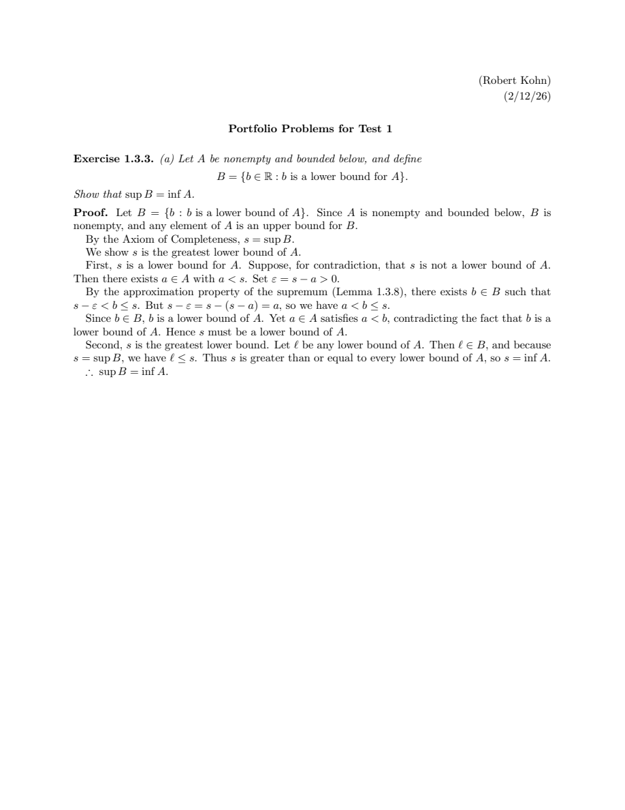
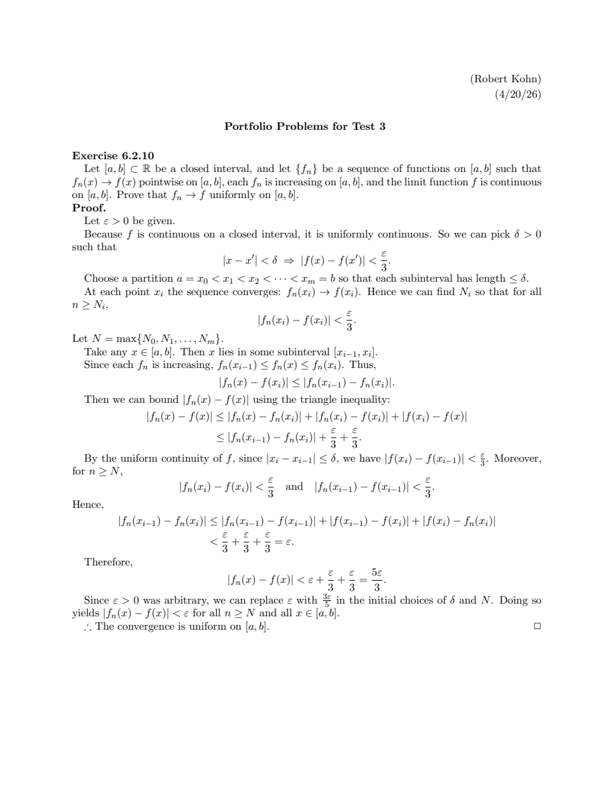

# MTH 337: Real Analysis — LaTeX Coursework

This repository contains selected mathematical writing and LaTeX coursework completed for **MTH 337: Real Analysis** at Muhlenberg College. The coursework focuses on the theoretical foundations of single-variable calculus, including the Axiom of Completeness, sequences and series, point-set topology of the real line, continuity, power series, and Riemann integration.

The documents included here represent my individual proof portfolios submitted for the three course exams. Each document was written in LaTeX using standard AMS packages and contains formal, step-by-step mathematical proofs.

---

## Highlights

### 1. [Portfolio Problems 1](portfolio-problems-1/)
Proofs on foundational analysis, including the duality of infima and suprema ($\sup B = \inf A$), the existence of $\sqrt{2}$ via least upper bounds, and convergence criteria for geometric sequences ($(b^n) \to 0 \iff -1 < b < 1$).



---

### 2. [Portfolio Problems 2](portfolio-problems-2/)
Proofs on series convergence, compactness, and continuity. Highlights include a proof of the Alternating Series Test using the Monotone Convergence Theorem on even and odd subsequences, an open-cover contradiction proof of compactness via nested intervals, an $\varepsilon$-$\delta$ proof of the limit of Thomae's function, and a three-case proof that increasing functions satisfying the Intermediate Value Property are continuous.


---

### 3. [Portfolio Problems 3](portfolio-problems-3/)
Proofs on sequences of functions, power series, and Riemann integration. Includes a proof that increasing functions converging pointwise to a continuous function on $[a,b]$ converge uniformly, a proof of termwise power series integration and differentiability, and a Darboux-sum proof that the uniform limit of Riemann-integrable functions is Riemann-integrable.



---

## Skills Demonstrated

### LaTeX & Document Structure
- AMS document class (`amsart`) and package configuration
- AMS proof environments (`\begin{proof} ... \end{proof}`)
- Displayed equations, multi-line alignments, and mathematical notation
- Clean preambles without obsolete drivers or unused font commands

### Technical Writing & Mathematical Exposition
- Deductive mathematical proof structure
- Contradiction arguments using Archimedean and least upper bound properties
- Epsilon-delta ($\varepsilon$-$\delta$) and epsilon-N ($\varepsilon$-$N$) limit proofs
- Multi-case proofs for domain boundaries
- Darboux sums and partition analysis for Riemann integration

---

## Repository Structure

```text
.
├── README.md
├── .gitignore
├── assets/
│   └── previews/
│       ├── supremum-infimum-duality-proof.png
│       ├── completeness-root-two-proof.png
│       ├── alternating-series-proof.png
│       ├── thomae-function-limit-proof.png
│       ├── uniform-convergence-proof.png
│       └── riemann-integrability-proof.png
├── portfolio-problems-1/
│   ├── README.md
│   ├── main.tex
│   └── main.pdf
├── portfolio-problems-2/
│   ├── README.md
│   ├── main.tex
│   └── main.pdf
└── portfolio-problems-3/
    ├── README.md
    ├── main.tex
    └── main.pdf
```

---

## Compiling the Documents

Each folder contains a standalone `main.tex` and a pre-compiled `main.pdf`. To compile any of the documents locally, navigate to the folder and run `pdflatex`:

```bash
cd portfolio-problems-1
pdflatex main.tex
```

Or using `latexmk`:

```bash
latexmk -pdf main.tex
```

Requirements: Any standard LaTeX distribution (TeX Live, MacTeX, or MiKTeX). No non-standard packages or custom `.sty` files are needed.

---

## About Me

**Robert Kohn**  
Muhlenberg College  
Triple Major: Mathematics · Statistics · Physics  
GitHub: [https://github.com/rkohnmn](https://github.com/rkohnmn)
