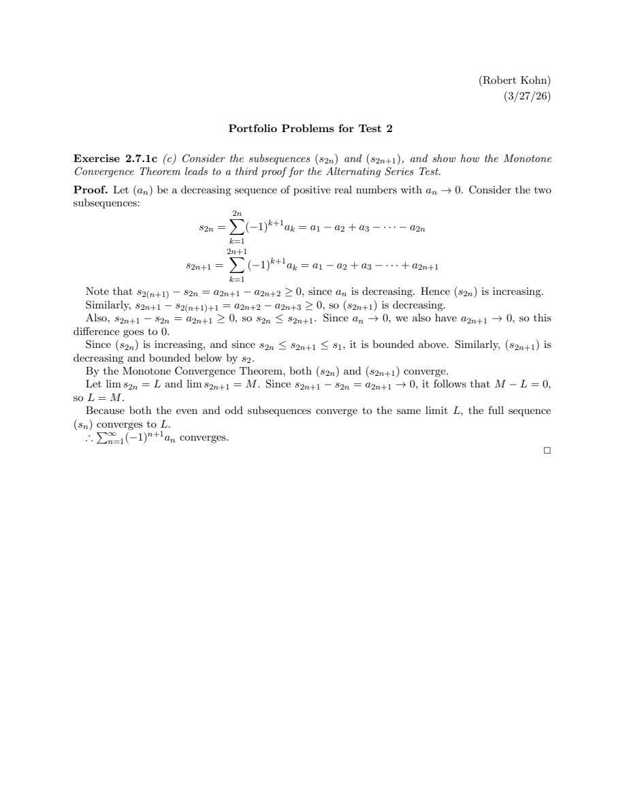

# Portfolio Problems 2

Selected proofs on infinite series, point-set topology, and continuity, completed for Real Analysis (MTH 337) at Muhlenberg College.

## Goal

Provide rigorous mathematical proofs covering alternating series convergence, open-cover compactness, epsilon-delta functional limits, and topological continuity.

## What I Created

A 5-page LaTeX document containing complete proofs for four major problems:
- **Exercise 2.7.1c:** Proving the Alternating Series Test via the Monotone Convergence Theorem by splitting partial sums into even subsequence $(s_{2n})$ (increasing, bounded above) and odd subsequence $(s_{2n+1})$ (decreasing, bounded below).
- **Exercise 3.3.9c:** Proving compactness by contradiction via nested closed intervals $I_n$ with lengths $|I_n| \to 0$, showing that $I_n$ eventually lies within a single open set $O_{\lambda_0}$, contradicting the lack of a finite subcover.
- **Exercise 4.2.3c:** Formulating and proving the limit of Thomae's function ($\lim_{x \to 1} t(x) = 0$) using an $\varepsilon$-$\delta$ proof based on the finiteness of rational denominators bounded by $1/\varepsilon$.
- **Exercise 4.5.3:** Proving that an increasing function $f$ on $[a,b]$ satisfying the Intermediate Value Property is continuous on $[a,b]$, separated into three cases (interior points, left endpoint, and right endpoint).

## Technologies

- LaTeX (`amsart` document class)
- AMS packages (`amsmath`, `amssymb`, `amsfonts`, `amsthm`, `fullpage`, `graphicx`, `color`)

## Features

- Subsequence decomposition
- Contradiction arguments with open covers and nested intervals
- Formal $\varepsilon$-$\delta$ proofs
- Comprehensive multi-case analysis for boundary values

## Mathematical Content

- Monotone Convergence Theorem and series convergence
- Compactness, open coverings, and finite subcovers
- Thomae's function and rational denominator bounds
- Intermediate Value Property and continuity

## Preview



## Files

- `main.tex` — LaTeX source
- `main.pdf` — compiled reference output

## Compiling Locally

Compile with `pdflatex`:

```bash
pdflatex main.tex
```
